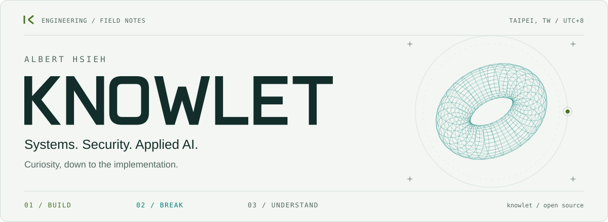

<picture>
  <source media="(max-width: 640px) and (prefers-color-scheme: dark)" srcset="./assets/hero-mobile-dark.svg">
  <source media="(max-width: 640px)" srcset="./assets/hero-mobile-light.svg">
  <source media="(prefers-color-scheme: dark)" srcset="./assets/hero-dark.svg">
  
</picture>

[Writing](https://knowlet3389.blogspot.com/) &nbsp; / &nbsp; [Talks](https://slides.com/knowlet) &nbsp; / &nbsp; [LinkedIn](https://www.linkedin.com/in/knowlet) &nbsp; / &nbsp; [All repositories](https://github.com/knowlet?tab=repositories)

### Albert Hsieh / knowlet

I build tools across **systems, security, and applied AI**: protocol bridges, agent experiments, and software that makes everyday workflows more useful. Based in **Taipei, Taiwan**.

**Go** &nbsp; · &nbsp; **Rust** &nbsp; · &nbsp; **Python** &nbsp; · &nbsp; **TypeScript** &nbsp; / &nbsp; Linux · Docker · React
