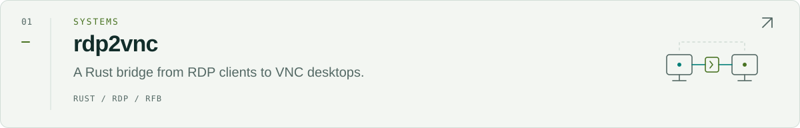
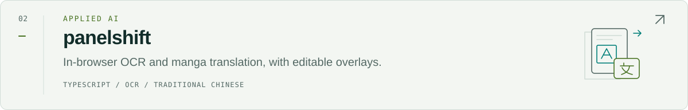
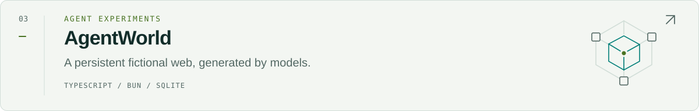
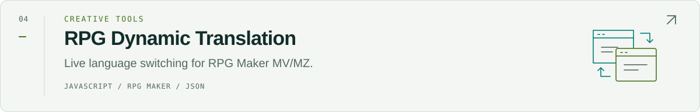

<picture>
  <source media="(max-width: 640px) and (prefers-color-scheme: dark)" srcset="./assets/hero-mobile-dark.svg">
  <source media="(max-width: 640px)" srcset="./assets/hero-mobile-light.svg">
  <source media="(prefers-color-scheme: dark)" srcset="./assets/hero-dark.svg">
  
</picture>

[Writing](https://knowlet3389.blogspot.com/) &nbsp; / &nbsp; [Talks](https://slides.com/knowlet) &nbsp; / &nbsp; [LinkedIn](https://www.linkedin.com/in/knowlet) &nbsp; / &nbsp; [All repositories](https://github.com/knowlet?tab=repositories)

### Albert Hsieh / knowlet

I build tools across **systems, security, and applied AI**: protocol bridges, agent experiments, and software that makes everyday workflows more useful. Based in **Taipei, Taiwan**.

**Go** &nbsp; · &nbsp; **Rust** &nbsp; · &nbsp; **Python** &nbsp; · &nbsp; **TypeScript** &nbsp; / &nbsp; Linux · Docker · React

## Selected work

<a href="https://github.com/knowlet/rdp2vnc">
  <picture>
    <source media="(max-width: 640px) and (prefers-color-scheme: dark)" srcset="./assets/projects/rdp2vnc-mobile-dark.svg">
    <source media="(max-width: 640px)" srcset="./assets/projects/rdp2vnc-mobile-light.svg">
    <source media="(prefers-color-scheme: dark)" srcset="./assets/projects/rdp2vnc-dark.svg">
    
  </picture>
</a>

<a href="https://github.com/knowlet/panelshift">
  <picture>
    <source media="(max-width: 640px) and (prefers-color-scheme: dark)" srcset="./assets/projects/panelshift-mobile-dark.svg">
    <source media="(max-width: 640px)" srcset="./assets/projects/panelshift-mobile-light.svg">
    <source media="(prefers-color-scheme: dark)" srcset="./assets/projects/panelshift-dark.svg">
    
  </picture>
</a>

<a href="https://github.com/knowlet/agentworld-web-simulator">
  <picture>
    <source media="(max-width: 640px) and (prefers-color-scheme: dark)" srcset="./assets/projects/agentworld-mobile-dark.svg">
    <source media="(max-width: 640px)" srcset="./assets/projects/agentworld-mobile-light.svg">
    <source media="(prefers-color-scheme: dark)" srcset="./assets/projects/agentworld-dark.svg">
    
  </picture>
</a>

<a href="https://github.com/knowlet/RPGDynamicTranslation">
  <picture>
    <source media="(max-width: 640px) and (prefers-color-scheme: dark)" srcset="./assets/projects/rpg-translation-mobile-dark.svg">
    <source media="(max-width: 640px)" srcset="./assets/projects/rpg-translation-mobile-light.svg">
    <source media="(prefers-color-scheme: dark)" srcset="./assets/projects/rpg-translation-dark.svg">
    
  </picture>
</a>

### In the lab

- **[JevGuard-NSFA](https://github.com/knowlet/JevGuard-NSFA)** — Experiments in agent risk classification using the SingGuard-NSFA taxonomy and benchmark.
- **[MasqueCat](https://github.com/knowlet/MasqueCat)** — An experimental [Tailcat](https://github.com/tailscale/tailcat) fork exploring HTTP/3 MASQUE transport.

Project index &amp; notes

| Project | What it does |
| --- | --- |
| [rdp2vnc](https://github.com/knowlet/rdp2vnc) | A Rust bridge from RDP clients to existing VNC desktops. An early implementation with documented compatibility limits. |
| [Panelshift 譯格](https://github.com/knowlet/panelshift) | In-browser OCR and manga translation with editable Traditional Chinese overlays. Optional translation APIs receive extracted text. |
| [AgentWorld Web Simulator](https://github.com/knowlet/agentworld-web-simulator) | Generates a persistent fictional web through a constrained UI catalog. Inspired by [hanxiao's simulator](https://github.com/hanxiao/qwen-agentworld-35b-a3b-web-simulator). |
| [RPGDynamicTranslation](https://github.com/knowlet/RPGDynamicTranslation) | External JSON translations and live language switching for RPG Maker MV/MZ. |

關於我 / 繁體中文

我是 Albert Hsieh，網路上使用 **knowlet**，在台北寫程式。我的專案涵蓋系統工具、資安研究與 AI 應用，從 RDP/VNC 協定橋接、Agent 實驗，到漫畫 OCR 與 RPG 遊戲翻譯。

主要使用 Go、Rust、Python 與 TypeScript，也在[部落格](https://knowlet3389.blogspot.com/)記錄實作與研究。[演講資料](https://slides.com/knowlet)收錄過去的技術分享。

 

<picture>
  <source media="(prefers-color-scheme: dark)" srcset="./assets/footer-dark.svg">
  
</picture>
